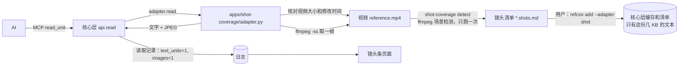

# 设计文档：镜头覆盖率应用 `apps/shot-coverage`（初稿，等审阅）

EN summary: Design for the shot-coverage app, on top of the core changes C1–C4 and C6 that are already done. A `detect` command runs ffmpeg scene detection once and writes a Markdown shot list; the user registers the list with the `shot` adapter, which is one self-contained file loaded by path. Reading a shot checks the video's size and mtime (recomputing the SHA-256 only if they changed), then extracts one keyframe with ffmpeg and returns text plus a JPEG. No further core change is needed: the adapter finds the repository root by walking up from its own file, which the loader guarantees lies inside the repository. The shot-strip page is generated from the core's own report and read records. Status: draft for review, 2026-11-14; implementation tasks follow after the review.

状态：**初稿，2026-11-14，等用户审阅。** 依据 `requirements.md`（第二稿）。核心层的 C1、C2、C3、C4、C6 已做完并各自提交（`23038a3`、`ee611df`、`4500173`、`f344f5f`、`496cfe4`），真实关键帧在 CLI 里测过（`docs/验证结果.md` 第 10 项）。**审阅通过之前不写应用代码。**

## 1. 总览



- **核心层不动**：登记的始终是一份小 Markdown，走原来的路径；`read` 经 C1 的通路拿到图片。
- **适配器只有一个文件** `adapter.py`：核心层按配置里写的路径加载它，加载时不改 `sys.path`，所以它只能 import 标准库和 `refcov`，不能靠兄弟文件（`refcov/adapters/loader.py` 的约定）。
- **命令和页面** 在 `cli.py`、`page.py`，是普通脚本，可以 import `adapter.py`（`cli.py` 开头把自己的目录放进 `sys.path`），不被核心层加载。

文件布局：

| 路径 | 内容 | 谁加载 |
|---|---|---|
| `apps/shot-coverage/adapter.py` | 清单格式、单元 ID、边界合并、ffmpeg 调用、适配器接口（`name`、`kinds`、`split`、`read`、`facts`） | 核心层（按配置路径）、`cli.py`、测试 |
| `apps/shot-coverage/cli.py` | `detect` 和 `page` 两个子命令 | 用户在终端运行 |
| `apps/shot-coverage/page.py` | 生成镜头条 HTML | `cli.py` |
| `apps/shot-coverage/README.md` | 最短步骤、局限（英文） | 用户 |
| `tests/test_shot_*.py` | 属性测试（不用 ffmpeg）和合成视频测试（要 ffmpeg，没有就跳过） | pytest |

## 2. 镜头清单格式（需求 1.2）

UTF-8、换行 `\n`，`detect` 写，适配器的 `split` 读。例子：

```markdown
# reference shots

video: reference.mp4
sha256: 3f0c…（64 位十六进制）
size: 941265067
mtime_ns: 1731542400123456789
duration: 460.0
threshold: 0.25
min_shot: 0.5
shots: 44

## shot-00-00-0
start: 0.0
end: 3.8

## shot-00-03-8
start: 3.8
end: 6.6
```

- **文件头**是第一个 `## ` 之前的 `键: 值` 行。键固定：`video`（相对仓库根目录、用 `/`；仓库外的视频写绝对路径）、`sha256`、`size`（字节）、`mtime_ns`（整数，纳秒）、`duration`（秒）、`threshold`、`min_shot`、`shots`（镜头数）。第一行 `# …` 只是标题，适配器忽略。
- **镜头小节**：二级标题就是镜头 ID，下面两行 `start:`、`end:`（秒，保留一位小数）。
- `split` 严格校验，不合格抛 `ValueError`（登记时变成"适配器拆分失败"，什么都不写）：文件头键齐全且格式对；`shots` 等于小节数；第一个镜头从 0.0 开始；每个镜头的 `start` 等于上一个的 `end`；最后一个的 `end` 等于 `duration` 保留一位小数；每个小节的 ID 等于由 `start` 生成的 ID；`end` 大于 `start`。这样清单被手改坏了，登记会拒绝，而不是悄悄登记一份有空隙的清单。
- **时间取到 0.1 秒**：检测到的边界先四舍五入到 0.1 秒再用，所以首尾相接是精确相等，不靠浮点比较（写成字符串、读回整数十分之一秒比较）。

**单元 ID**：`shot-<分>-<秒>-<十分之一秒>`，由起点的十分之一秒整数 `t` 算：`shot-{t//600:02d}-{t//10%60:02d}-{t%10}`（分钟超过两位时照常多写）。不含空白和方括号；起点至少相隔 `min_shot`，所以不重名。

## 3. 适配器 `adapter.py`

### 3.1 对核心层的接口

- `name = "shot"`；`kinds = {"shot": KindDecl(strict=True, key=False)}`（需求 1.6）。
- `split(data, file_name) -> list[Unit]`：解析清单，每个镜头一个 `Unit(id, title=id, kind="shot", text=…)`。**单元的 `text` 不是给 AI 看的内容，而是校验值的输入**（需求 3.1）：

  ```
  video-sha256=<视频的 SHA-256>
  start=<起点，一位小数>
  end=<终点，一位小数>
  threshold=<阈值>
  min_shot=<最短镜头时长>
  ```

  核心层照常对这段文字取 SHA-256 当单元校验值。视频变了（清单重新检测）、起止时间变了、参数变了，校验值就变，旧读取记录自然失效（骨架需求 1.4）。
- `read(data, file_name, unit_id) -> [文字, Image]`：见 3.2。核心层（C1）在拿日志锁和写记录**之前**调用它，抛任何异常都不写记录。
- `facts(data, file_name, unit_id) -> dict`：`{"index", "of", "start", "end", "duration", "video_sha256"}`。核心层现在没有调用它，保持接口完整（骨架需求 2.1）。

### 3.1.1 导入 `adapter.py` 时不做任何耗时的事（用户 2026-11-14 审阅补）

**每次写文件关卡检查都会经 `api._decls` 加载适配器**（`gather` 为了算必看集合，对清单里用到的每个适配器调一次 `loader.load`；MCP 服务每次读取也会加载）。加载靠的是导入这个文件，所以：

- 模块顶层**只放** import、常量、`dataclass` 和函数定义、`name`、`kinds`；不调 ffmpeg 和 ffprobe、不查 `PATH`（`shutil.which` 也不在导入时调）、不算哈希、不读视频、不读清单、不开子进程、不联网。
- 所有耗时的事（`which`、`subprocess`、`sha256_file`、读视频）只在 `split` 之外的函数体里做，且只在 `read` 和 `detect` 被调用时才发生。
- 核心层有加载缓存（按路径、修改时间、大小），改了适配器文件才重新导入；但第一次导入和改文件后的第一次导入仍在关卡的路径上，所以这条要守住。
- **测试守住**（`tests/test_shot_adapter_import.py`）：把 `subprocess.run`、`subprocess.Popen`、`shutil.which`、`refcov.store.sha256_file`、`hashlib` 的文件哈希换成"一调用就失败"的替身，再用 `loader.load` 导入适配器：必须成功、不触发任何替身，并且导入用时不超过 0.5 秒；另有一个静态检查（`ast`）：模块顶层的语句只能是 import、赋值、函数和类定义、文档字符串，顶层赋值的右边不能是函数调用（`KindDecl(...)`、`dataclass` 装饰器、`re.compile` 这类除外，白名单写在测试里）。

### 3.2 `read` 的步骤

1. 解析清单（核心层读缓存里的那份），找到这个单元；找不到抛 `KeyError`。
2. **找视频**：`video` 是相对路径时，相对**仓库根目录**。适配器自己找根目录：从 `adapter.py` 所在位置（`Path(__file__).resolve()`）往上走，第一个含 `.git` 的目录。`refcov/adapters/loader.py` 保证适配器文件在仓库里，所以一定走得到；MCP 服务的当前目录不一定是仓库根目录（`docs/验证结果.md` 第 6 项），所以不用当前目录。**这样不需要给核心层再加改动。**
3. **核对视频没变**（需求 3.4）：
   - 路径不是存在的普通文件 → 抛错，提示"视频不在清单记的位置，请重新检测并登记"。
   - 当前的 `size`、`mtime_ns` 和文件头一致 → 通过。
   - 不一致 → 重算 SHA-256（分块读，`refcov.store.sha256_file`）：和文件头一致 → 通过（例如复制过、只是修改时间变了）；不一致 → 抛错，提示"视频变了，请重新检测并登记"。
   - 通过的 `(路径, size, mtime_ns)` 记在进程内的集合里，同一个进程里后面的读取不再核对 SHA-256。
4. **取关键帧**（需求 2.1–2.4）：中点 `(start+end)/2`，调用

   ```
   ffmpeg -nostdin -v error -ss <中点> -i <视频绝对路径> -frames:v 1
          -vf scale='min(960,iw)':-2 -q:v 4 -f image2pipe -c:v mjpeg -
   ```

   `subprocess.run(..., stdin=DEVNULL, capture_output=True, timeout=60)`。**`-nostdin` 和 `stdin=DEVNULL` 缺一不可**：真实实测里没加的那次，同一个时间点在 MCP 服务里两次超时（`docs/验证结果.md` 第 10 项，原因是推测）。退出码不为 0 或输出为空 → 抛错并带 ffmpeg 的前 300 个字符的 stderr。`-ss` 放在 `-i` 前面是快速定位，EP01 上每帧 0.3–0.9 秒。
5. **返回** `[文字, Image(jpeg, "image/jpeg")]`。文字只写事实，不描述画面：

   ```
   shot-00-21-1: 21.1–25.3 s (4.2 s), shot 3 of 44. Keyframe: one frame from the middle of the shot (23.2 s).
   A single frame does not show text or motion that appears elsewhere in the shot.
   ```

   最后一句是把局限直接告诉 AI（需求 1.8 的另一个落点）；读取记录由核心层写：`text_units=1`、`images=1`（需求 2.6）。

### 3.3 为什么不把取帧放进登记

关键帧现取现用、不存盘（需求 2.4、3.3）：登记时存 44 张图要占缓存，而且对比试验的运行文件夹是复制模板建的，缓存会被复制进每一次运行。代价是每次读取多花 0.3–0.9 秒 ffmpeg 时间，EP01 上可以接受。

## 4. 检测 `detect`（需求 1、4）

`python apps/shot-coverage/cli.py detect <视频> [--out <清单>] [--threshold 0.25] [--min-shot 0.5]`，在仓库根目录运行（和 `refcov` 一样，当前目录下要有 `.git`）。

1. 找 `ffmpeg`、`ffprobe`（`shutil.which`）；缺哪个就报哪个，附安装提示，什么都不写（需求 4.4）。
2. `ffprobe` 取时长；`sha256_file` 算视频的 SHA-256；`os.stat` 取 `size`、`mtime_ns`。
3. **场景检测**，只跑这一次：

   ```
   ffmpeg -nostdin -hide_banner -i <视频> -an -vf "scale=-2:360,select='gt(scene,<阈值>)',showinfo" -f null -
   ```

   从 stderr 的 `showinfo` 行里取 `pts_time:`，得到切换时间点列表。**先缩到 360 行高再检测**，为了在 8 分钟 1080p 的视频上达到需求 4.6 的"2 分钟内"。缩小会改变场景分数，所以**实现时要用 EP01 校准**：看阈值 0.25 下抓到的硬切数和位置是否仍和 `docs/DEVLOG.md` 2026-11-14 记的 43 处硬切一致（用仓库外的标准答案对，不进仓库）；不一致就改成不缩小或换缩小比例，把实际用的写进清单文件头（`threshold` 之外加 `detect_scale`）。
4. **边界处理**（纯函数 `build_shots(cuts, duration, min_shot)`，不用 ffmpeg，可属性测试）：四舍五入到 0.1 秒、去重、去掉 0 和 `duration` 上的点；从前往后，凡是会产生比 `min_shot` 还短的镜头的切点，去掉（并入前一个）；最后一个镜头如果短于 `min_shot`，并入倒数第二个。保证首尾相接、覆盖 `[0, duration]`、每个镜头不短于 `min_shot`（视频本身比 `min_shot` 短时是唯一的一个镜头）。
5. 写清单（先写临时文件再改名，不留半份）；打印镜头数、时长、阈值、清单路径、下一步的登记命令。镜头数小于 2 或大于 300 时加一行提示（需求 1.7）。
6. 默认输出位置（需求 1.1）：视频在仓库里 → 放在视频旁边；视频在仓库外 → 放在仓库根目录。`--out` 覆盖。清单必须在仓库里，否则 `refcov add` 会拒绝。
7. 登记（用户在终端）：`refcov add <清单> --id <参考源ID> --adapter shot`，前提是用户已在配置里写了 `[adapters]` 的 `shot = "apps/shot-coverage/adapter.py"`。

## 5. 镜头条页面 `page.py`（需求 5）

`python apps/shot-coverage/cli.py page [--source <参考源ID>] [--out strip.html]`，在仓库根目录运行，只读，只写这个 HTML。

- **数据**全部来自核心层，不另算覆盖率：
  - 镜头列表和是否读过：`api.list_units(store, source)`（`read` 字段是"历史上有效读取"）；
  - 起止时间：用适配器 `split` 解析缓存里的清单（和核心层读到的是同一份）；
  - 被需求引用的镜头：`api.gather(store).cited`；
  - 图片张数、文字段数：`api.report(store, None)["by_session"]` 的 `images`、`text_units`；
  - 回放用的读取顺序：`store.records()` 里 `type == "read"` 的记录，取时间和单元，且只算校验值和清单当前一致的（有效读取）。
- **渲染**：一个 `<div>` 一排格子，一镜头一格，`flex-grow` 按时长成比例，最小宽度保证短镜头可见；亮（读过）、灰（没读）、带标记（被引用，加边框和角标）。标题行：`读过 N / 共 M 个镜头`、图片张数、一句局限（需求 1.8）。格子上的 `title` 属性写镜头 ID 和起止时间。
- **回放**：页面里内联一小段脚本（不联网，用户 2026-11-14 同意可以用脚本）：按读取记录的顺序一格格点亮，带播放、暂停和进度条。**关掉脚本也显示最终状态**：格子的亮灰在服务端就写进 class，脚本只在回放时临时改。
- **不嵌关键帧或视频画面**（需求 5.5）。
- **共用的视觉语言**（定位文档第 7 节）：格子的样式写成 `render_strip(cells, …)` 一个函数，图层应用的字段表和演示页以后复用同一份 CSS 变量；本规格只做镜头条。

## 6. 配置、保护和安全

- `[adapters]` 在配置文件里，**只由用户改**（骨架需求 14.2）。`integrations/kiro/refcov.example.toml` 里已有注释示例。
- 适配器文件是代码，会在 MCP 服务和钩子的进程里被加载运行。它和仓库里别的代码一样受写文件关卡管，但**核心层不能替用户判断它可信不可信**：用户点名的文件就当可信。README 要写明这一点。
- 清单里的 `video` 路径是登记时的缓存内容，用户登记前应该看一眼。适配器只接受"存在的普通文件"，不接受网址或 ffmpeg 的特殊输入（`concat:` 之类）：解析路径后用 `Path.is_file()` 判断，传给 ffmpeg 的是解析后的绝对路径。
- ffmpeg 的 stderr 可能带路径，错误消息里只留前 300 个字符。
- **README 局限要写明（用户 2026-11-14 审阅补）**：适配器文件是普通代码，改它的 `kinds` 声明（例如把 `strict` 改成 `False`）就能缩小必看集合。这和改核心层代码同类，属于"不防蓄意伪造"（骨架需求 11.4）；RefCov 防偷懒和虚报，不防有意改代码。写文件关卡会管适配器文件的写入，但管不了有意绕开的人。
- 对外局限（README 和页面）：只切硬切；一个镜头一张关键帧，看不到镜头里随时间出现的字（真实测试里板子镜头三行字只读到一行）；读过一个镜头的关键帧不等于看过其中每个画面。

## 7. 测试

| 测试 | 内容 | 要 ffmpeg |
|---|---|---|
| 属性测试：`build_shots` | 随机切点和 `min_shot`：首尾相接、覆盖全片、每个镜头不短于 `min_shot`、切点是输入的子集 | 否 |
| 属性测试：清单往返 | 随机镜头序列写成清单再 `split`：单元 ID 满足骨架需求 2.5、单元数等于镜头数、同一份清单拆两次 ID 和校验值相同 | 否 |
| 属性测试：校验值 | 视频 SHA-256、任一起止时间、阈值、最短镜头时长变一个，对应单元的校验值就变；不变的单元校验值不变 | 否 |
| 清单校验 | 有空隙、重叠、ID 对不上起点、`shots` 数不对、缺键：`split` 抛 `ValueError` | 否 |
| 视频核对 | 假视频文件（普通字节）：大小和修改时间一致时放行；改了内容、大小不变且修改时间变：重算 SHA-256 后拒绝；只改修改时间：重算后放行；文件不存在：拒绝 | 否 |
| 合成视频：检测 | 用 `lavfi` 的 `color` 拼 3 段各 2 秒的红绿蓝视频：检测出 2 个切点，3 个镜头 `[0,2]`、`[2,4]`、`[4,6]` | 是 |
| 合成视频：读取 | 经核心层 `api.read` 读一个镜头：返回文字和 1 张 JPEG（能解码、宽度不超过 960），记录 `images=1`；取帧失败时不写记录 | 是 |
| 端到端 | `detect` → 登记（`refcov.cli` 的 `add --adapter shot`）→ 经 MCP 读全部镜头 → `check` 达标；视频被改后读取被拒绝且日志不变 | 是 |
| 页面 | 生成的 HTML 里：格子数 = 镜头数、读过的格子数对、被引用的带标记、不含 `` 和 `http` | 否 |
| 导入守卫（第 3.1.1 节） | 用"一调用就失败"的替身换掉 `subprocess`、`shutil.which`、`sha256_file`，经 `loader.load` 导入适配器：成功、不触发替身、不超过 0.5 秒；`ast` 静态检查顶层语句 | 否 |
| 核心层名字检查 | `tests/test_core_names.py` 已有，核心层源码里没有应用名（C6） | 否 |

测试都用合成视频或假字节，**仓库里不放 EP01 的任何帧或视频**（需求 7.4）。没有 ffmpeg 的环境里"要 ffmpeg"的测试用 `pytest.mark.skipif` 跳过并写明原因；CI 的 Linux 和 Windows 作业已装 ffmpeg（C6）。

## 8. 参数初值（实测后定）

| 参数 | 初值 | 在哪里定 |
|---|---|---|
| 场景检测阈值 | 0.25 | 需求 1.5 |
| 最短镜头时长 | 0.5 秒 | 需求 1.5 |
| 检测前缩小 | 高 360 | 用 EP01 校准（第 4 节第 3 步） |
| 关键帧宽度、JPEG 质量 | 960 像素、`-q:v 4` | 真实测试里 12.7–89 KB，读得清（验证结果第 10 项） |
| 每镜头关键帧数 | 1，取中点 | 用户 2026-11-14 定 |
| 取帧超时 | 60 秒 | 实测每帧不到 1 秒 |
| 镜头数提示 | 少于 2 或多于 300 | 需求 1.7 |

## 9. 需求和设计对照

| 需求 | 设计 |
|---|---|
| 1.1–1.3、1.5 | 第 2、4 节 |
| 1.4、1.6、1.7 | 第 2、3.1、4 节 |
| 1.8 | 第 3.2 第 5 步、第 5、6 节 |
| 2.1–2.6 | 第 3.2 节、第 3.3 节 |
| 3.1 | 第 3.1 节（`Unit.text` 就是校验值输入） |
| 3.2–3.4 | 第 2、3.2 节第 3 步、第 4 节 |
| 4.1–4.7 | 第 4 节第 1、4–7 步 |
| 5.1–5.5 | 第 5 节 |
| 6.1–6.3 | 不新增关卡逻辑，第 1 节 |
| 7.1–7.5 | 第 6、7 节 |
| 8.1–8.3 | 核心层报告已有（骨架需求 17.3）；第 5 节数据来源；`cli.py` 另加一个只读的小子命令 `count`，从读取记录数出"读过几个镜头、几张图"（需求 8.2） |

## 10. 需要用户看的几点

1. **没有新的核心层改动。** 初稿里留给设计的 D1（适配器怎么拿到仓库根目录）用"从适配器文件往上找 `.git`"解决，不改核心层。代价：适配器文件必须放在仓库里（加载器本来就要求），且仓库里嵌套多个 `.git` 时以最近的那个为准。
2. **检测前缩小到 360 行高**是为了速度，会不会改变 EP01 上的硬切数要实现时校准；校准结果不符合就退回不缩小，需求 4.6 的"2 分钟"也相应放宽。
3. **读取时只核对大小和修改时间**，大小和修改时间都没变但内容变了的视频（极少见）核对不出来。需求 3.4 就是这样写的；README 会写明。
4. **页面里有一小段内联脚本**（回放用），不联网；关掉脚本仍显示最终状态。
5. 实现顺序建议：清单格式和纯函数（`build_shots`、ID、校验）及其属性测试 → 适配器 `split`/`read` 加视频核对 → `detect` → 端到端 → 页面 → README。每一步单独提交。

**审阅结论（2026-11-14）：设计批准**，补三处：第 3.1.1 节（导入时不做耗时的事，测试守住）、第 6 节 README 局限加一条（改 `kinds` 缩小必看集合，属于不防蓄意伪造）、下面第 11 节。检测前缩小到 360 行高的校准用 EP01 和仓库外的标准答案做，结果记进 DEVLOG。IDE 里的关键帧测试先不做，等用户回来。

## 11. 给对比试验用（用户 2026-11-14 审阅补）

视频对比试验里装了 RefCov 的一组（B 组）要的模板，按下面放。试验本身的设计、提示词、判分另写在 `docs/视频对比试验设计.md`，这里只写应用这一侧要准备什么。

B 组模板（仓库外，`D:\agent\kiro\refcov-trial\VB-template\`）里要有：

| 东西 | 放哪里 | 谁做 |
|---|---|---|
| 空的 `.git` 目录 | 模板根目录 | 做模板的人 |
| `adapter.py` 的副本 | `apps/shot-coverage/adapter.py`（路径和配置里写的一致） | 做模板时复制，不连到仓库 |
| `refcov.toml`，里面有 `[adapters]` 的 `shot = "apps/shot-coverage/adapter.py"`，严格模式，`requirements` 和 `spec_files` 按试验需要写 | 模板根目录 | 用户（配置只能用户改） |
| 登记好的镜头清单（`reference.shots.md`）和它的登记结果（状态目录里的清单文件、缓存、日志） | 模板根目录和状态目录 | **`detect` 由 agent（Kiro）跑；`refcov add` 由用户在终端跑** |
| 钩子和 MCP 配置（和 `B-template` 一样：`hook.py`、4 个钩子、MCP 指向这次运行的文件夹） | `.kiro/` 下，`run_trial.py` 在运行文件夹里写 MCP 配置 | 做模板的人、`run_trial.py` |
| `reference.mp4` | **不放在模板里**：每次运行由 `run_trial.py` 用硬链接放进运行文件夹的根目录，名字不变 | `run_trial.py` |

要点：

- **清单里的视频路径写相对路径 `reference.mp4`**（`detect` 在放了硬链接的目录里跑，或用 `--video-path` 之类的参数指定要写进清单的路径；实现时选一个，写进 README）。模板被复制成运行文件夹后，路径仍然对得上。
- **硬链接保持大小和修改时间不变**，所以运行时的核对（需求 3.4）走快速通过，不会每个运行都重算 941 MB 的 SHA-256。
- 模板里的清单是用模板位置的视频生成的；复制出运行文件夹后视频换成新的硬链接（同一个文件），SHA-256、大小、修改时间都一样。
- 状态目录里的缓存只有那份清单（几 KB），复制模板不会复制视频。
- 运行文件夹的临时目录要设在运行文件夹里面（`TEMP`、`TMP` 环境变量），应用不往系统临时目录写东西；适配器取帧走管道，不落盘。
- 对比试验用的是 EP01，里面有真实公司名字：清单里只有时间，不含画面文字，可以放进仓库外的模板；帧不存盘。
